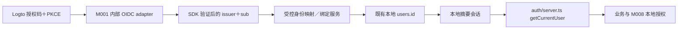

# M013：当前网站接入设计与第二阶段验收

2026-10-22。本文是接入设计，**不是已挂载的业务功能**；本阶段没有本地用户迁移、身份映射表或 OIDC 网站入口。实验见 [模块说明](../labs/logto-oidc/README.md)。

## 现状核查

- M001 `src/modules/auth/server.ts` 是集成边界：`getCurrentUser`、`getUserByToken`、`revokeSession`、`findRegisteredUserByEmail`、认证 DTO 和公开昵称服务。浏览器调用 `client.ts` 与 HTTP API，不应导入服务／SDK。
- `session.ts` 从 `hackathon_session` 读随机令牌；`service.ts` 对令牌摘要查询 `sessions`，有效期 7 天，不自动续期。邮箱验证码在事务内消费并按规范化邮箱创建／查询 `users`；这条旧登录逻辑不能拿来实现 OIDC 自动绑定。
- `AuthUser` 为 `{id,email,createdAt:Date}`，HTTP DTO 的日期是字符串。`users.id` 是本地 UUID，`email` 非空唯一；资料表 `account_profiles` 另外保存昵称。修改邮箱或昵称不会成为授予业务权限的依据。
- 表外键覆盖：sessions、account_profiles、event_registrations、event_materials（含 processed_by）、event_assets、ticket_orders／ticket_order_keys、event_teams／team_members／team_applications、managed_content.updated_by、project_likes／project_comments、administrators 和权限审计等；具体定义以各模块 schema 为准。不能用 Logto sub 替换这些 UUID。
- M008 `authorizeAdmin(db,user,permission)` 按本地 `user.id` 查询有效 `administrators` 及权限；Logto Console 角色、邮箱域名、ID token 中的 roles 都不能代替它。保留原管理员记录及修订、双权限边界和原子审计。
- 当前 M001 只有开发邮件适配，生产验证码登录被禁用。现有开发邮箱／开发会话不能证明正式旧账号所有权，生产回退路径尚未就绪。

## 目标边界（第二阶段）

SDK 只存在于 M001 内部服务端适配层；业务模块继续消费相同 AuthUser、公开昵称接口和 Cookie 查询边界。优先采用经实测兼容当前 Next 16.4 App Router 的官方 SDK，阅读安装版本指南后再写实际代码。网站回调不直接返回 Logto token 给前端，也不把 Logto access token 当成本站业务 API 的本地 session。

建议新增内部接口（尚未实现）：`verifyOidcCallback` → VerifiedExternalIdentity；`resolveExternalIdentity` → 本地用户或 LinkRequired；`beginIdentityLink`／`completeIdentityLink`；`createLocalSession`／按 source 撤销。只有 SDK 校验成功、nonce 和服务端流程状态匹配的来源能构造 VerifiedExternalIdentity，不能接受浏览器直接提交的 issuer/sub/email 作为证据。

## 映射与并发约束（设计，无本轮迁移）

建议追加 `external_identities`：id、本地 userId FK、配置的 providerKey、**准确 issuer＋大小写敏感 subject**、createdAt、linkedAt、lastAuthenticatedAt、linkMethod、审计关联。对 `(issuer,subject)` 唯一，同一身份只能属于一个本地用户；第一版再对 `(userId,issuer)` 唯一，暂不支持一个本地用户绑定同 issuer 多身份。

Issuer 必须与可信 discovery 的 `issuer` 完全相等，不按任意 URL 前缀放行、不剥离路径、不任意合并不同 tenant。邮件只是可变声明，不能做身份主键。实验已验证的相同 sub 仅适用于本次 issuer／两个客户端；以后不同 tenant、第三方 IdP 或 pairwise subject 需重新验收，不假定所有产品的 sub 天然相同。

建议 `identity_link_requests` 保存本地用户、当前本地会话摘要／版本、预期 issuer、用途、随机一次性 state 摘要、nonce／PKCE 服务端关联、两份证据关联、5 分钟失效与消费时间、修订号；不保存明文 token、验证码或不必要的邮件内容。增加只追加身份绑定／冲突／解绑审计。映射、消费请求、会话轮换与审计必须使用共享写协调器＋同一数据库事务；唯一冲突不得用 upsert 重指向另一个本地 userId。

## 旧账号关联与冲突

1. 首次 OIDC 登录：先验证签名／issuer／audience／state／nonce／时间与 PKCE。若已有精确身份映射，查原本地 userId，不根据这次 email 修改映射或本地角色。
2. 无映射且邮箱与本地账号相同：返回“需要关联旧账号”，不创建重复账号、不按邮箱合并、不调用旧 `verifyCode` 或 `onConflictDoUpdate(email)`。相同邮箱、`email_verified=true` 均不足以自动绑定旧数据。
3. 已有旧账号的可信持有人主动发起绑定：取得**可信旧账号重新验证**，再做中央新鲜认证（`prompt=login`／`max_age`，核对 auth_time）。两份证据绑定同一短期操作和本地会话；显示绑定目标及后果，最终同源确认后原子写映射并轮换 session。不能只凭一个长期 Cookie、一次 OIDC 邮箱验证或管理人员输入同名邮箱完成绑定。
4. 本站旧账号来自开发邮箱，默认不具备可信旧账号证据。需另行建立人工账号恢复：审查可核验的历史正式所有权资料、独立渠道和审批记录；没有证据就暂停关联，不把 Mailpit、`/dev/mail`、开发验证码或当前开发会话升级成所有权证明。若未来已有经过独立验收的正式旧认证，可作为可信重新验证来源；仍需双端确认。
5. 无邮箱冲突且允许新用户：必须取得满足本站策略的正式邮箱证明，再原子创建新的本地 UUID 和身份映射；当前 users.email 非空唯一，缺失或未验证邮件进入补充流程，不伪造 email、复用已有 UUID 或绕开约束。实验邮件证据不能触发正式账号创建。
6. 身份已绑定另一个用户、用户已绑定同 issuer 的其他身份、并发绑定、会话用户变化、过期／重复 state：409／拒绝，不转移数据。误绑纠正采用专门人工恢复和审计，不暴露“一键合并／按邮箱查账号”的公开接口。

注销 Logto 账号、email 变更、issuer 更换和旧账号解绑均不能通过自动字符串匹配移动用户数据。解绑前必须保证另一个**可信且可用**的登录／恢复方式，不能把开发邮箱当回退，不能删除最后可恢复凭据。管理员旧账号的恢复还需受控复核，任何步骤都不能自动 grant／bootstrap 网站管理员。

## 会话、切换与回退

第二阶段继续发行随机不透明本站 Cookie、数据库只存摘要；建议追加 source（email／oidc）、provider/identity FK、authTime、sessionVersion，以便只撤销新方式会话。OIDC token 如确需存储应加密、最小权限、单独过期及轮换；没有服务端 API 用途就不额外发 token 给业务模块。

本地 cookie、Logto 中央会话、各客户端 refresh token 是不同对象。网站退出立即撤销当前本站会话；中央退出只能按已验证上游语义展示，不能宣称撤销其他产品已有本地会话。敏感操作使用新鲜认证／本地权限复查；中央禁用后的本地会话失效时限需明确设计（短期会话、定期查状态、撤销事件／back-channel 等）并实测，第一阶段不承诺全局即时失效。

通过关闭 OIDC 功能开关／移除入口回退，保留 mappings、审计和原 users 数据；按 source 撤销 OIDC 本地会话，既有可信 email 会话按原策略保留。**当前生产旧邮件登录不可用**，上线前必须先完成正式回退通道验收；不以重新启用开发邮箱作为生产紧急恢复。测试环境切换只能在独立 DB 先演练，真实环境变更属于下一阶段单独授权范围。

## 第二阶段具体改动与验收标准

| 改动 | 必须通过的验收 |
| --- | --- |
| M001 内部官方 SDK adapter、固定发行方白名单、启用开关、独立回调及安全 next | 默认仍旧方式；关闭时入口／API 不可用；state/nonce/PKCE/issuer/audience/签名/过期/回调重放拒绝；回调与跳转不开放重定向 |
| 外部身份、短期绑定请求与审计的**追加迁移** | 先停服备份，旧表内容／外键摘要和数据不变；一 issuer/sub 只能映射一 user；并发绑定只有一次成功；失败无半份映射或审计 |
| 新账号创建与旧账号双证明绑定／人工恢复 | 同邮箱绝不自动合并；未验证邮箱、开发邮箱及旧开发 Cookie 不能绑定；异账号会话／过期／重放／冲突拒绝；确认后原有报名、材料、队伍、订单、点赞、评论和昵称仍指向同一 UUID |
| 本地 session source/version、轮换／撤销、切换及回退 | 不接受 Logto token 直接充当业务 Cookie；绑定／登录前后 SID 轮换；退出即失效；回退保留旧账号、mapping、资料和审计；中央退出影响边界实测并准确说明 |
| M008 兼容与管理员恢复保护 | 原超管／运营 userId 和权限不变；Logto roles 或相同邮箱不能提权；撤权后新旧方式访问都拒绝；敏感操作复查权限 |
| 正式邮件、TLS、密钥／客户端和跨产品 issuer 配置 | 不使用 Mailpit；各产品精确 HTTPS 回调和 host-only Secure Cookie；客户端 secret 不共享；轮换、过期、服务故障及回退演练 |
| UI、文档、回归 | 中英文／手机／登录返回；旧 M001—M012 回归和所有新增服务／浏览器测试；干净 CI、生产关闭测试、恢复手册与维护责任完整 |

第二阶段只在用户另行指定后实施；本文件不授权执行以上迁移、账号绑定、默认登录切换或生产部署。
