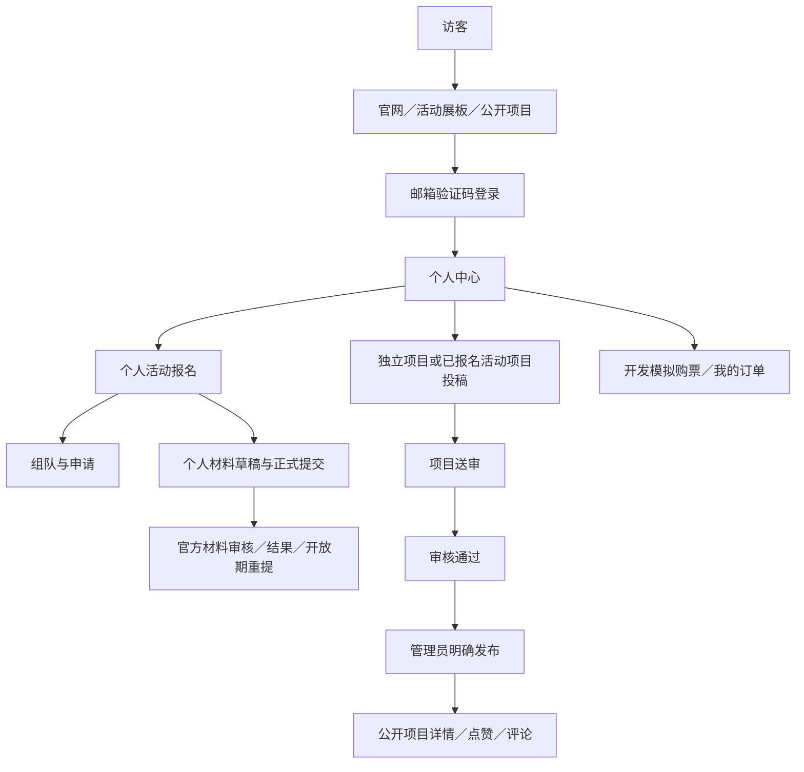

# 完整用户流程与状态恢复

候选：M001—M015＋PR #5 邮件／日期修复＋独立安全整改。仅当前已实现行为，不表示已部署生产；模块接口以各 README 为准。所有页面支持现有中英文及手机布局。本文不含真实账号、联系方式、验证码或运营政策。

## 入口与环境

- 官网首页 `/` → 活动 `/events`、项目 `/projects`；未知／未发布活动和未公开项目不提供公开详情。
- 原站本机 3000 使用自己的原环境；真实 QQ SMTP 另在 127.0.0.1:3105，`npm run mail:preview` 启动。两个数据目录、Cookie 主机及用途需分清；不要覆盖原环境。
- production 当前禁用开发邮箱／本机 SMTP／OIDC／模拟购票。下面账户与业务流程是已开发功能的验收路径，不等于 production 已有可用注册入口。

材料审核结果不会自动进入项目展板；组队不共享个人材料；购买观众票不产生参赛资格。

## 访客、账户与选手

| 流程／入口 | 身份与前提 | 正常结果 | 失败与恢复 | 对应测试 |
| --- | --- | --- | --- | --- |
| 首页、活动、项目 | 匿名即可；仅已发布内容 | 导航、双语、搜索组合筛选、分页与 URL 条件恢复，项目进入详情 | 无匹配显示空态；未知／下架为 404，不回退旧静态项目 | homepage、navigation、event-board、project-board |
| 登录 `/login?next=…` | 可用的邮箱适配，本站安全返回地址 | 发送 6 位码→真实邮箱或开发夹具收信→验证码→首次创建用户或复用原 UUID→返回目标 | 60 秒间隔、每邮箱小时 5 次、每来源小时 20 次；过期 10 分钟、最多 5 次尝试；重发旧码失效；外站 next 拒绝。SMTP 不确定不自动重发 | auth、smtp-auth、return-path、login |
| 个人中心 `/account` | 有效会话；未登录回登录页 | 查看账号／昵称和已有入口，刷新保留登录；退出删除当前会话 | 过期后重新验证；不要删除用户或重新初始化来修复登录。已绑定 OIDC 身份的原防旁路规则保留，本轮不解绑 | auth、profile、login |
| 活动详情 `/events/:id` | 公开活动 | 查看阶段、规则、报名／材料／团队任务与真实开放原因 | 活动阶段与报名／提交窗口分别判断；结束不意味着自动公开材料 | event-board、participant-center |
| 报名 `/register` 子页 | 已登录，报名窗口开放 | 账号邮箱只读，填写姓名／角色／地区等声明；重复报名返回已有记录，成功即资格 | 未开放／截止不写；报名成功资料只读；同用户可分别报名多活动 | event-participation |
| 团队 `/teams`、`/my-team`、`/applications` 子页 | 公开招募可浏览；写操作需本人已报名、组队开放 | 队长建团、招募；成员申请→队长通过／拒绝；撤回、移交、离队、移除、解散按身份处理 | 一人每活动一队、一份待处理申请；默认 2—4 人。满员／解散申请过期；队长需移交或解散后退出；截止只读。修订冲突刷新重确认 | participant-center |
| 个人材料 `/materials` 子页 | 本人已报名，提交期开放 | 项目基本资料＋赛道＋封面／PDF＋声明；独立草稿→正式提交→待审核 | 未报名不能上传；截图最多 6；保存草稿不改正式稿；失败保留；409 不覆盖旧页面输入，读取最新状态后重确认 | event-participation、material-review |
| 查看材料审核结果 | 本人正式材料 | 待审核／通过／驳回；驳回原因可见，开放期内可修改重提，重提回待审核 | 原提交截止仍有效；通过只读；通过被撤回显示待审核及公开原因。内部协调及备注不返回选手 | material-review |

## 项目作者与公众互动

| 流程／入口 | 前提与动作 | 结果与恢复 | 对应测试 |
| --- | --- | --- | --- |
| 投稿 `/projects/submit` → `/account/projects/:id` | 登录，幂等创建；创作者名称不用邮箱兜底。填写名称、简介、说明、分类、封面和授权；链接仅 HTTPS，截图／PDF 可选 | 独立项目不限提交时间；关联活动须本人报名、提交期开放，首次送审后活动关联固定。未知创建结果复用请求键 | project-submission |
| 草稿／送审 | 保存带草稿修订号；正式提交需完整资料、原创性／素材／公开授权 | 草稿不公开，不影响正在审核或线上旧版；每次送审创建不可变版本，旧版本不能再审核。活动截止后禁止上传／保存／重提 | project-submission |
| 审核反馈与重提 | 作者查看驳回原因，修改草稿后再次提交 | 回到待审核；冲突保留输入。管理员不代改作者内容、不读未提交草稿，PDF 永不公开 | project-submission |
| 新版与下架 | 已发布项目可以改稿送审；作者主动下架须原因 | 审核期间保留线上旧版；批准不自动替换。作者下架撤销授权，恢复需重新确认授权、送审、批准和发布，不能用旧批准恢复 | project-submission |
| 浏览、点赞／评论 | 公开详情可匿名看；写互动需登录，评论还需公开昵称 | 点赞切换及评论真实落库；评论请求幂等、限流，作者可删除。无收藏／回复功能；不显示假数量或账号邮箱 | project-interaction |
| 项目／所属活动下架 | 公众可见性重新检查 | 公开图片／互动不可借旧地址绕过；数据与历史保留。活动恢复后还要看项目自身状态；作者撤销授权的项目不自动恢复 | project-submission、project-interaction |

## 官方人员

| 流程／入口 | 权限与动作 | 失败／恢复与结果 | 对应测试 |
| --- | --- | --- | --- |
| 首位管理员初始化 | 先注册已有账号，停同库网站，执行 admin:bootstrap；无公开初始化 API | 一次性绑定，账号不存在拒绝，重复不重新提权；不自动给予原邮箱白名单权限 | admin |
| 管理员授权 `/admin/administrators`／权限审计 `/admin/audit` | 仅超级管理员，已有账号授予 operator／super_admin、停用恢复、查看记录 | 禁止自停用／自降级和移除最后有效超管；修订冲突不覆盖。撤权下一请求失效，普通用户无自助提权 | admin |
| 材料总表 `/admin/materials` → 详情 | 两类有效管理员；搜索、活动／赛道／状态／协调筛选、统计、分页 | 默认审核跟随活动日期，可不限时／自定义／暂停；配置变更要原因和审计，关闭后不能审核／撤回／改协调。看附件与历史仍可 | material-review |
| 材料决定／撤回／协调 | 双修订绑定正式版本；通过或驳回，驳回原因必填；通过可撤回，公开原因必填 | 撤回不改正式提交版本／附件；协调独立，不冒充审核决定。重提保留协调但提示关联旧版本。权限／窗口／状态与审计同事务 | material-review |
| 项目管理 `/admin/projects` → 详情／preview | 两类管理员，查看正式稿和私有审核 PDF；项目审核不限时 | 待审核→通过／驳回；驳回原因作者可见，内部备注不公开；正式修订改变后拒绝处理旧版 | project-submission |
| 项目发布／下架 | 当前送审版本已批准且作者授权有效才能明确发布；下架要原因 | 新版发布才替换线上稿；演示项目仅预览和上下架，没有虚构作者或审核记录。旧 ID 和互动保留 | project-submission |
| 活动 `/admin/events`、首页 `/admin/content/homepage` | 两类管理员，结构化双语编辑、保存草稿、授权预览、发布／下架 | 修订＋审计原子；保存不影响公众。活动下架隐藏入口、保留报名／材料；首页下架恢复明确的默认演示内容。审核与发布分开 | content-management |
| 评论管理 `/admin/project-comments` | 两类管理员，隐藏／恢复、原因与修订 | 隐藏内容不返回公众；作者删除不恢复私人正文，操作记录保留 | project-interaction |

## 开发模拟票务

入口 `/preview/ticketing/demo`、`/checkout`、`/orders`，仅 development 且显式开关启用；production 和关闭开关时页面／API 均禁止，不进入正式收款流程。

1. 选一种票及数量→登录安全返回→填写购买人问卷及政策→500ms 自动权威报价。输入变化废弃旧报价；失败保留问卷并可重试，报价不占库存。
2. 确认订单→幂等创建、原子预留→保存 orderId／URL→发起或恢复支付尝试。存在未完成订单时先继续它，未知网络结果先查单，不能另付。
3. 模拟渠道成功经服务器核对后才显示成功，重复／乱序通知不能重复扣库存；失败／取消按服务端状态允许重试；未知显示确认中，不自动释放预留或再付。
4. 改票先查支付状态、确认关闭渠道交易／订单，再释放库存并返回选票；未确认关闭不能直接返回购买。超时先查单／关单，迟到成功标待对账，不宣称购票成功。
5. 我的订单按账号和活动分页展示历史快照，进入原订单详情；不提供退款、核销或真实票券。每账号累计限购 5 张，默认保留 15 分钟且不越过售票截止。

对应 ticketing.test、ticketing-fixture.test、ticketing.spec、ticketing-ui.spec、ticket-orders.spec；未知结果、重复点击、金额篡改和他人订单均有断言。浏览器夹具相对日期仅隔离数据库生效，真实演示日期不延长。

## 统一异常恢复

401 重新登录并回原站内目标；403 核对角色／所有权，不靠隐藏按钮授权；404 核对发布状态和归属，不恢复静态旧数据绕过；409 保留输入，读最新状态重新确认；网络结果未知先查服务端状态，避免盲目重放创建／发布／付款。未保存离开提醒、确认弹窗、键盘焦点恢复及手机布局沿用已有模块。

服务未运行时从项目目录启动对应进程；相同 PGlite 目录不能并发维护。不得删库、重置库存、重新 bootstrap 或复制他人凭据来恢复业务。生产条件与后续任务见 RELEASE-READINESS.md。
